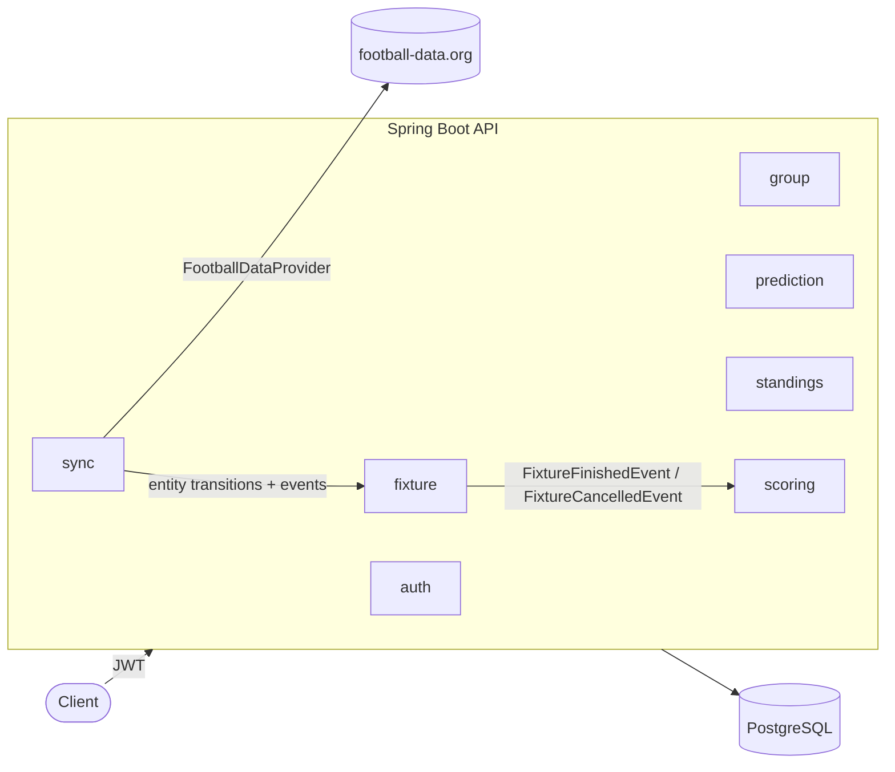
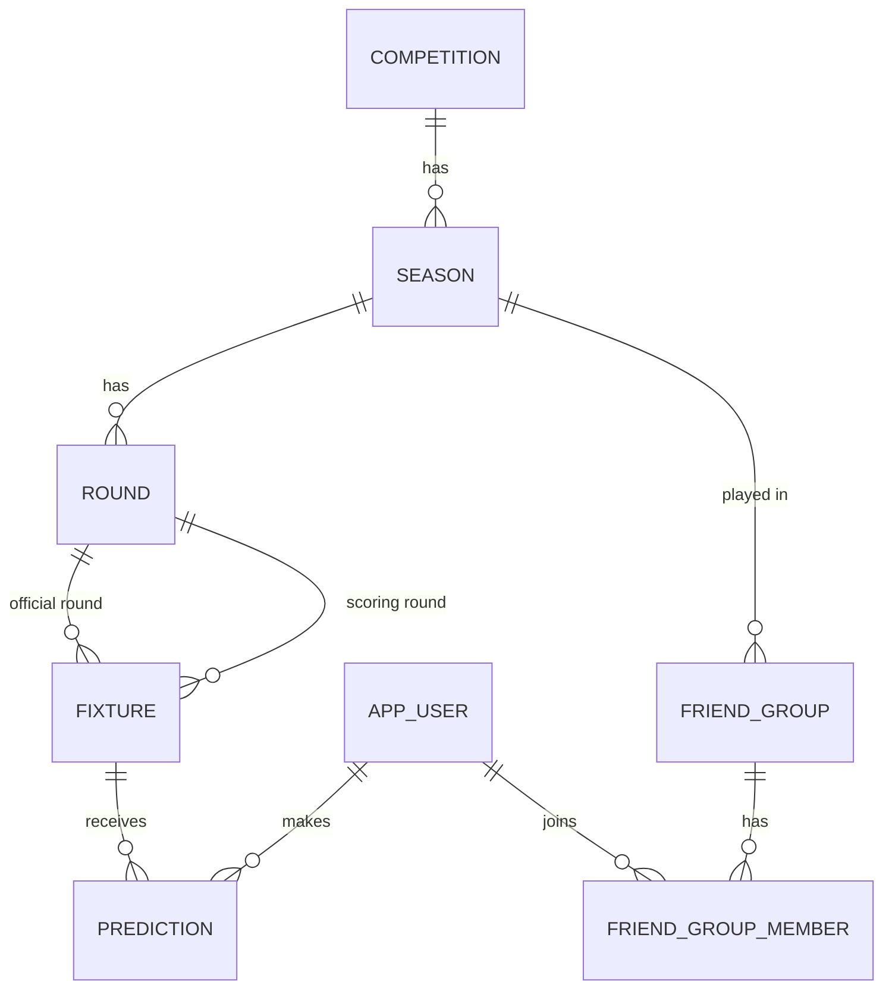
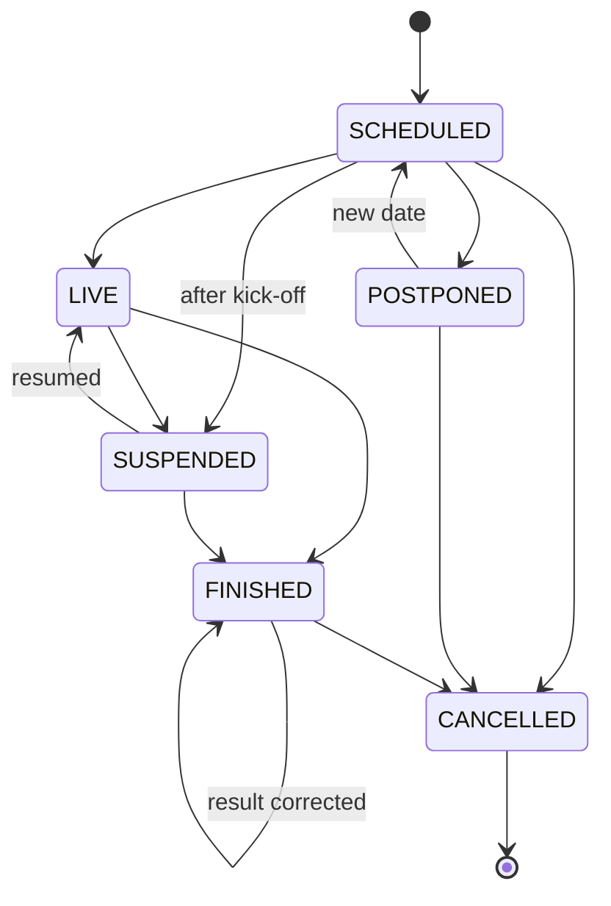

# Football Predictions


A REST API for **football prediction games between friends**: create a private group for a competition,
predict the score of every match, and compete in season-long and round-by-round standings.
Fixtures, kick-off times and results are synchronized automatically from [football-data.org](https://www.football-data.org).

## Features

- **Authentication** with JWT (Spring Security OAuth2 Resource Server), BCrypt passwords and `USER` / `ADMIN` roles
- **Friend groups** with invite codes, one competition season per group, member limits and owner rules
- **Predictions** for every match, editable until kick-off, stored with an atomic PostgreSQL upsert
- **Automatic scoring**: 3 points for the exact score, 1 for the correct outcome — recalculated if a result is corrected
- **Standings** per season and per round, with tie-breaks, computed in a single SQL query with window functions
- **Hidden predictions**: other members' predictions are revealed only once each match has started
- **Real fixture lifecycle**: postponed, rescheduled, suspended, cancelled and brought-forward matches
- **Automatic sync** with football-data.org: daily calendar sync and result polling only while matches are being played
- **Season lifecycle**: seasons start and finish automatically; groups of finished seasons become read-only
- **OpenAPI / Swagger UI** documentation with JWT authorization

## Tech stack

| Area | Technology |
|---|---|
| Language | Java 25 |
| Framework | Spring Boot 4 (Web MVC, Data JPA, Security, Validation, Scheduling) |
| Security | Spring Security OAuth2 Resource Server (JWT, HS256), BCrypt |
| Database | PostgreSQL 18, Flyway migrations, JPA + `NamedParameterJdbcTemplate` for reporting queries |
| External data | football-data.org REST API via Spring `RestClient` |
| API documentation | springdoc-openapi (Swagger UI) |
| Testing | JUnit 5, Mockito, MockMvc, Testcontainers, `MockRestServiceServer` |
| Infrastructure | Docker Compose, GitHub Actions |

## Architecture

The code is organized **by feature** rather than by layer: each package contains its own controller,
service, repository, entities and DTOs.



- **`fixture`** owns the match lifecycle. When a match finishes or is cancelled it publishes a domain event;
  **`scoring`** listens and (re)calculates points, so fixtures know nothing about points.
- **`sync`** talks to football-data.org through the `FootballDataProvider` interface (adapter pattern).
  Only the adapter knows the provider's JSON and status codes; the rest of the application works with its own model.
- **`standings`** uses plain SQL for aggregations; everything else uses JPA.

### Data model



Predictions belong to the **user and the match**, not to a group: one prediction counts in every group of that
competition, and deleting a group never deletes predictions.

### Fixture lifecycle



Every transition is a method on the entity (`postpone()`, `reschedule()`, `finish()`…) that validates the current
state, so the same rules apply whether a change comes from an administrator or from the sync.

## Game rules

| Rule | Behaviour |
|---|---|
| Scoring | 3 points for the exact score, 1 for the correct outcome (home win / draw / away win), 0 otherwise |
| Deadline | Each match closes at its own kick-off time |
| Missing prediction | 0 points |
| Tie-break | More exact scores first; if still tied, players share the position |
| Postponed match | Counts in the round **in which it is played**, so closed rounds never change |
| Suspended match | Predictions stay closed (the match already started); it scores when completed |
| Cancelled match | Scores nothing; points already awarded are removed |
| Corrected result | Points are recalculated from scratch |
| Finished season | Its groups become read-only (standings remain visible) |

## API

Full interactive documentation: `http://localhost:8080/swagger-ui.html`.

| Area | Endpoints |
|---|---|
| Auth | `POST /api/auth/register` · `POST /api/auth/login` · `GET /api/users/me` |
| Seasons | `GET /api/seasons` · `GET /api/seasons/{id}/rounds` |
| Fixtures | `GET /api/rounds/{roundId}/fixtures` |
| Predictions | `PUT /api/fixtures/{fixtureId}/prediction` · `GET /api/rounds/{roundId}/predictions/me` |
| Groups | `POST /api/groups` · `POST /api/groups/join` · `GET /api/groups` · `GET /api/groups/{id}` · `DELETE /api/groups/{id}/members/me` · `DELETE /api/groups/{id}` |
| Standings | `GET /api/groups/{id}/standings` · `GET /api/groups/{id}/standings/rounds/{roundId}` · `GET /api/groups/{id}/rounds/{roundId}/predictions` |
| Admin | `POST /api/admin/fixtures` · `PUT /api/admin/fixtures/{id}/result` · `POST /api/admin/fixtures/{id}/postpone` · `PUT /api/admin/fixtures/{id}/schedule` · `POST /api/admin/fixtures/{id}/suspend` · `POST /api/admin/fixtures/{id}/cancel` · `POST /api/admin/sync/seasons/{id}` |

Errors follow RFC 9457 (`ProblemDetail`): `400` validation, `401` missing or invalid token, `403` forbidden,
`404` not found (also for groups you are not a member of), `409` business rule violated, `503` provider unavailable.

## Getting started

### Prerequisites

- JDK 25
- Docker
- A free [football-data.org](https://www.football-data.org) API token (only needed for the sync)

### Configuration

| Environment variable | Required | Description |
|---|---|---|
| `JWT_SECRET` | In production | HS256 signing key, at least 32 bytes. A development default is used if missing |
| `FOOTBALL_DATA_TOKEN` | For the sync | football-data.org API token |

### Run

```bash
git clone https://github.com/YOUR_GITHUB_USER/football-predictions.git
cd football-predictions
./mvnw spring-boot:run        # Windows: .\mvnw.cmd spring-boot:run
```

Spring Boot's Docker Compose support starts PostgreSQL automatically. Flyway creates the schema and seeds
LaLiga 2026/27 with its 38 rounds.

### First steps

1. Register and log in (`POST /api/auth/register`, `POST /api/auth/login`).
2. Promote your user to administrator (there is intentionally no endpoint for this):
   ```bash
   docker compose exec postgres psql -U predictions -d predictions \
     -c "UPDATE app_user SET role = 'ADMIN' WHERE email = 'you@example.com';"
   ```
3. Log in again so the token includes the role, then load the calendar: `POST /api/admin/sync/seasons/1`.
4. Create a group, share the invite code and start predicting.

### Postman

Import [`postman/football-predictions.postman_collection.json`](postman/football-predictions.postman_collection.json)
and run it with the Collection Runner. Requests store tokens and ids in collection variables and include automated tests.

### Tests

```bash
./mvnw verify                 # Windows: .\mvnw.cmd verify
```

Integration tests run against a real PostgreSQL container (Testcontainers). The football-data.org client is tested
with `MockRestServiceServer` and the sync with a mocked provider, so tests never call the real API.

## Synchronization with football-data.org

| Job | Schedule | What it does |
|---|---|---|
| Calendar | Daily at 04:30 (Europe/Madrid) | Full season sync: new fixtures, time changes, postponements, results |
| Matches in play | Every 5 minutes | Syncs **only** if a provider-linked match is about to start, in play, or started less than 24 h ago without a result |

- **No requests when there is no football**: the scheduler first checks the local database for matches in the play window.
- **Idempotent**: syncing the same data twice changes nothing; fixtures are matched by `external_id`.
- **Changes go through the domain**: the sync calls the same entity transitions as the admin endpoints and publishes
  the same events, so scoring and cancellations behave identically.
- **HTTP outside the transaction**: data is downloaded first and written in a separate transactional component, so a
  slow provider never holds a database connection.
- **Resilient**: provider errors (timeouts, 429, 5xx) are logged and retried on the next run; one bad match is skipped
  without aborting the whole sync.
- **No overlapping syncs**: a lock prevents the daily, live and manual syncs from running at the same time.

## Technical decisions

**Scoring round vs. official round.** Each fixture has an official round (`round_id`) and the round in which it
scores (`scoring_round_id`). A postponed match scores in the round that is in progress when it is finally played,
so standings of closed rounds never change weeks later.

**Robust round start dates.** Each round stores `starts_at`, computed from its fixtures but ignoring postponed,
cancelled and **brought-forward** matches (those more than 4 days before the round's median kick-off). It is
recomputed while the round has not started — to follow provisional dates being confirmed — and frozen once it starts.
The scoring-round rule only looks at these dates, so a single match moved weeks earlier cannot pull other matches into its round.

**Atomic upsert for predictions.** `INSERT … ON CONFLICT (user_id, fixture_id) DO UPDATE` makes create-or-update a
single atomic statement, so double submissions never create duplicates. `PUT` is idempotent by design.

**Standings in SQL.** Points, exact hits and positions are computed in one query using `SUM`,
`COUNT(…) FILTER (WHERE …)` and `RANK() OVER (…)`, starting from group members so players without predictions
still appear with 0 points.

**Domain events for scoring.** Finishing or cancelling a match publishes an event handled synchronously in the same
transaction: results and points are always consistent. *Trade-off:* an `AFTER_COMMIT` async listener would respond
faster but could leave a result without points if scoring failed.

**Pessimistic lock when joining groups.** Joining locks the group row (`SELECT … FOR UPDATE`) so two simultaneous
joins cannot exceed the member limit.

**Hidden predictions never leave the server.** Before kick-off, only the number of predictions is returned — not
just hidden in the UI. Postponed matches are not revealed, because their predictions reopen when they get a new date.

**404 instead of 403 for groups.** Non-members get `404` so group ids cannot be enumerated.

**Database constraints as the last line of defence.** Unique email (case-insensitive index on `lower(email)`),
one prediction per user and match, non-negative goals and "a finished match has a result" are enforced by PostgreSQL,
not only in Java.

**Roles in the JWT.** Avoids a database lookup per request. *Trade-off:* a revoked role stays valid until the token
expires (2 h); short-lived access tokens with refresh tokens would reduce that window.

**Injectable `Clock`.** Every time-dependent rule uses an injected `Clock`, which makes deadlines and the sync
window testable with a fixed time.

## Edge cases found while testing

- **Non-chronological test data** made a later round look "started" and captured rescheduled matches. This revealed
  the same risk with real brought-forward matches and led to the `starts_at` design above.
- **Manually created fixtures** (no `external_id`) kept the live sync polling the provider for 24 hours; the play
  window now only considers provider-linked fixtures.
- **Catching exceptions thrown by `@Transactional` beans** marks the whole transaction as rollback-only. The sync
  therefore applies changes through entity methods instead of transactional services, so a failing match can be
  skipped safely.

## Possible improvements

- Distributed lock for scheduled jobs (e.g. ShedLock) when running several instances
- Refresh tokens and token revocation
- Joker round multiplier (double points for one match per round)
- More competitions, including knockout rules (90-minute result)
- Notifications before each round closes
- React PWA client and deployment to AWS

## Project structure

```
src/main/java/com/raulcedroj/football_predictions
├── auth          # Registration, login, JWT issuing
├── common        # Global error handling, clock, scheduling config
├── competition   # Competitions, seasons, rounds and round start dates
├── fixture       # Fixtures, lifecycle transitions, scoring-round rule, admin endpoints
├── group         # Friend groups, invite codes, membership rules
├── prediction    # Predictions with upsert and kick-off deadline
├── scoring       # Scoring rules and event listeners
├── security      # Spring Security and JWT configuration
├── standings     # Standings and group predictions (SQL)
├── sync          # football-data.org adapter, sync service and scheduler
└── user          # Users and roles
```

## Author

**Raúl Cedeño Rojo** — Backend Developer (Java · Spring Boot)
[LinkedIn](https://www.linkedin.com/in/raulcedroj/)

Football data provided by [football-data.org](https://www.football-data.org).
