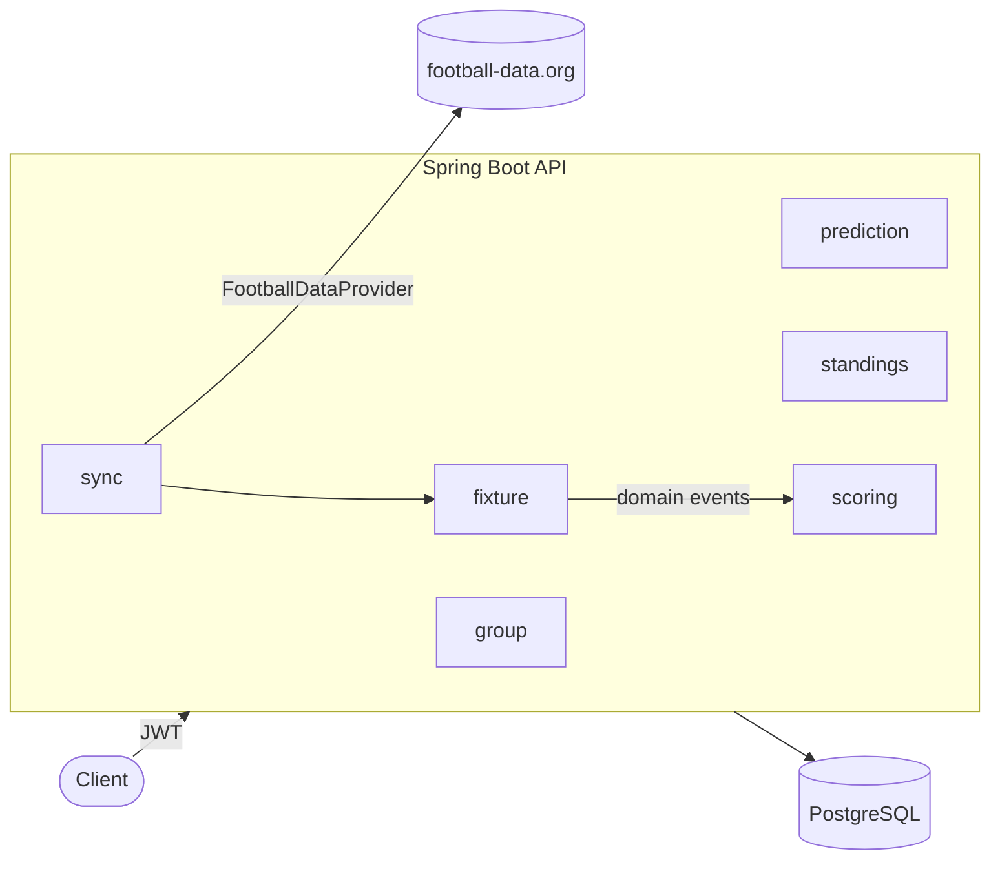

# Football Predictions


A REST API for **football prediction games between friends**: create a private group, predict the score of every
match and compete in season and round standings. Fixtures and results are synchronized automatically from
[football-data.org](https://www.football-data.org).

## Features

- **JWT authentication** with Spring Security, BCrypt passwords and `USER` / `ADMIN` roles
- **Friend groups** with invite codes, one competition season per group
- **Predictions** editable until kick-off, hidden from other members until the match starts
- **Automatic scoring** (3 points exact score, 1 correct outcome), recalculated if a result is corrected
- **Standings** per season and per round with tie-breaks, computed in a single SQL query
- **Automatic sync** with football-data.org, including postponed, suspended and cancelled matches
- **Swagger UI** with JWT authorization

## Tech stack

Java 25 · Spring Boot 4 (Web MVC, Data JPA, Security, Scheduling) · PostgreSQL 18 · Flyway · Spring `RestClient` ·
springdoc-openapi · JUnit 5 · Mockito · Testcontainers · Docker Compose · GitHub Actions

## Architecture



Code is organized **by feature**. Match results publish domain events that trigger scoring, and the external API is
isolated behind an adapter interface. See [docs/architecture.md](docs/architecture.md) for the data model, fixture
lifecycle, endpoints and sync design.

## Highlights

- **Atomic upsert** (`INSERT … ON CONFLICT`) so double submissions never duplicate a prediction
- **Standings with `RANK()` and `COUNT(…) FILTER`** in one query instead of aggregating in Java
- **Postponed matches score in the round in which they are played**, based on robust round start dates that ignore brought-forward matches
- **Pessimistic locking** so simultaneous joins never exceed a group's member limit
- **Zero API requests when no matches are being played**: the scheduler checks the local database first

Why each decision was taken, and its trade-offs: [docs/decisions.md](docs/decisions.md).
Game rules and special cases: [docs/game-rules.md](docs/game-rules.md).

## Getting started

**Prerequisites:** JDK 25, Docker and a free [football-data.org](https://www.football-data.org) token (only for the sync).

```bash
git clone https://github.com/raulced7/football-predictions.git
cd football-predictions
export FOOTBALL_DATA_TOKEN=your-token   # Windows: set it in your IDE run configuration
./mvnw spring-boot:run                  # Windows: .\mvnw.cmd spring-boot:run
```

PostgreSQL starts automatically with Docker Compose, and Flyway seeds LaLiga 2026/27.

1. Register and log in: `POST /api/auth/register`, `POST /api/auth/login`.
2. Promote your user to admin:
   ```bash
   docker compose exec postgres psql -U predictions -d predictions \
     -c "UPDATE app_user SET role = 'ADMIN' WHERE email = 'you@example.com';"
   ```
3. Log in again and load the calendar: `POST /api/admin/sync/seasons/1`.

- **API docs:** `http://localhost:8080/swagger-ui.html`
- **Postman:** import [`postman/football-predictions.postman_collection.json`](postman/football-predictions.postman_collection.json) and run it with the Collection Runner
- **Tests:** `./mvnw verify` (real PostgreSQL via Testcontainers; the external API is mocked)

## Author

**Raúl Cedeño Rojo** — Backend Developer (Java · Spring Boot) · [LinkedIn](https://www.linkedin.com/in/raulcedroj/)

Football data provided by [football-data.org](https://www.football-data.org).
