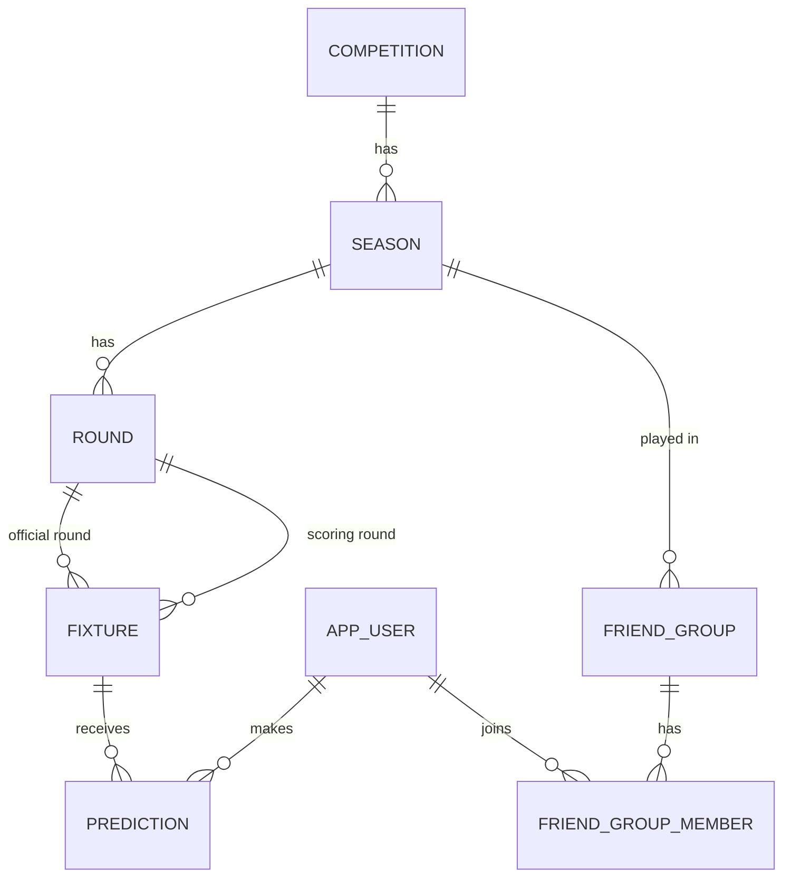
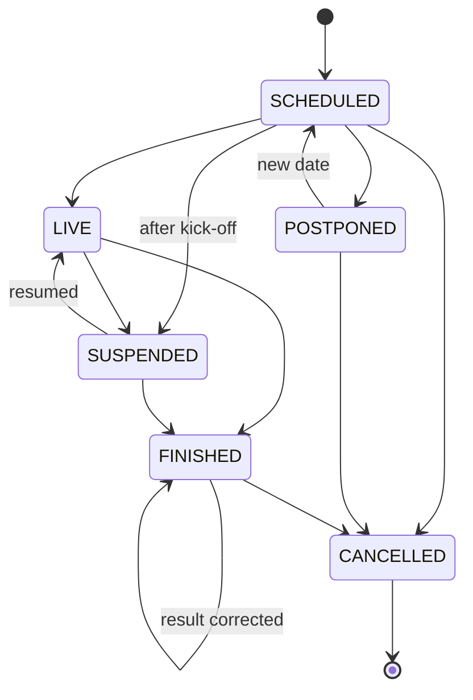

# Architecture

[← Back to README](../README.md)

## Packages

The code is organized **by feature**: each package contains its own controller, service, repository, entities and DTOs.

```
src/main/java/com/raulcedroj/football_predictions
├── auth          # Registration, login, JWT issuing
├── common        # Global error handling, clock, scheduling and OpenAPI config
├── competition   # Competitions, seasons, rounds and round start dates
├── fixture       # Fixtures, lifecycle transitions, scoring-round rule, admin endpoints
├── group         # Friend groups, invite codes, membership rules
├── prediction    # Predictions with upsert and kick-off deadline
├── scoring       # Scoring rules and event listeners
├── security      # Spring Security and JWT configuration
├── standings     # Standings and group predictions (SQL)
├── sync          # football-data.org adapter, sync service and scheduler
└── user          # Users and roles
```

- **`fixture`** owns the match lifecycle. When a match finishes or is cancelled it publishes a domain event;
  **`scoring`** listens and (re)calculates points, so fixtures know nothing about points.
- **`sync`** talks to football-data.org through the `FootballDataProvider` interface (adapter pattern). Only the
  adapter knows the provider's JSON and status codes.
- **`standings`** uses `NamedParameterJdbcTemplate` for aggregation queries; everything else uses JPA.

## Data model



- Predictions belong to the **user and the match**, not to a group: one prediction counts in every group of that
  competition, and deleting a group never deletes predictions.
- Each fixture has an **official round** (`round_id`) and the round in which it **scores** (`scoring_round_id`).
- Each round stores **`starts_at`**, used to decide the scoring round of rescheduled matches.
- The schema is managed with **Flyway**; Hibernate only validates it (`ddl-auto: validate`).

## Fixture lifecycle



Every transition is a method on the entity (`postpone()`, `reschedule()`, `finish()`…) that validates the current
state, so the same rules apply whether a change comes from an administrator or from the sync.

## API

Interactive documentation: `http://localhost:8080/swagger-ui.html`.

| Area | Endpoints |
|---|---|
| Auth | `POST /api/auth/register` · `POST /api/auth/login` · `GET /api/users/me` |
| Seasons | `GET /api/seasons` · `GET /api/seasons/{id}/rounds` |
| Fixtures | `GET /api/rounds/{roundId}/fixtures` |
| Predictions | `PUT /api/fixtures/{fixtureId}/prediction` · `GET /api/rounds/{roundId}/predictions/me` |
| Groups | `POST /api/groups` · `POST /api/groups/join` · `GET /api/groups` · `GET /api/groups/{id}` · `DELETE /api/groups/{id}/members/me` · `DELETE /api/groups/{id}` |
| Standings | `GET /api/groups/{id}/standings` · `GET /api/groups/{id}/standings/rounds/{roundId}` · `GET /api/groups/{id}/rounds/{roundId}/predictions` |
| Admin | `POST /api/admin/fixtures` · `PUT /api/admin/fixtures/{id}/result` · `POST /api/admin/fixtures/{id}/postpone` · `PUT /api/admin/fixtures/{id}/schedule` · `POST /api/admin/fixtures/{id}/suspend` · `POST /api/admin/fixtures/{id}/cancel` · `POST /api/admin/sync/seasons/{id}` |

Errors follow RFC 9457 (`ProblemDetail`): `400` validation, `401` missing or invalid token, `403` forbidden,
`404` not found (also for groups you are not a member of), `409` business rule violated, `503` provider unavailable.

## Synchronization with football-data.org

| Job | Schedule | What it does |
|---|---|---|
| Calendar | Daily at 04:30 (Europe/Madrid) | Full season sync: new fixtures, time changes, postponements, results |
| Matches in play | Every 5 minutes | Syncs **only** if a provider-linked match is about to start, in play, or started less than 24 h ago without a result |

- **No requests when there is no football**: the scheduler first checks the local database for matches in the play window.
- **Idempotent**: syncing the same data twice changes nothing; fixtures are matched by `external_id`.
- **Changes go through the domain**: the sync uses the same entity transitions and events as the admin endpoints.
- **HTTP outside the transaction**: data is downloaded first and written in a separate transactional component.
- **Resilient**: provider errors (timeouts, 429, 5xx) are logged and retried on the next run; one bad match is skipped
  without aborting the whole sync.
- **No overlapping syncs**: a lock prevents the daily, live and manual syncs from running at the same time.
- **Season lifecycle**: a season moves to `IN_PROGRESS` when its first match starts and to `FINISHED` when no match is
  pending; groups of finished seasons become read-only.

| football-data.org status | Application status |
|---|---|
| `SCHEDULED` | `SCHEDULED`, provisional time |
| `TIMED` | `SCHEDULED`, confirmed time |
| `IN_PLAY`, `PAUSED`, `EXTRA_TIME`, `PENALTY_SHOOTOUT` | `LIVE` |
| `FINISHED`, `AWARDED` | `FINISHED` |
| `POSTPONED` | `POSTPONED` |
| `SUSPENDED` | `SUSPENDED` |
| `CANCELLED` | `CANCELLED` |

## Configuration

| Environment variable | Required | Description |
|---|---|---|
| `JWT_SECRET` | In production | HS256 signing key, at least 32 bytes. A development default is used if missing |
| `FOOTBALL_DATA_TOKEN` | For the sync | football-data.org API token |

| Property | Default | Description |
|---|---|---|
| `app.groups.max-members` | `50` | Maximum members per group |
| `app.groups.max-owned-per-user` | `10` | Maximum active groups owned by a user |
| `app.sync.enabled` | `true` | Enables scheduled synchronization |
| `app.sync.calendar-cron` | `0 30 4 * * *` | Daily calendar sync |
| `app.sync.live-check-interval` | `PT5M` | Interval of the matches-in-play check |

## Testing

- **Integration tests** run against a real PostgreSQL container (Testcontainers) through MockMvc.
- The **football-data.org adapter** is tested with `MockRestServiceServer`, and the **sync** with a mocked
  `FootballDataProvider`: tests never call the real API.
- **Unit tests** cover the scoring rules (parameterized) and the scheduler (with a fixed `Clock`).
- **Test data is chronological** (later rounds have later dates), because round start dates depend on it.
